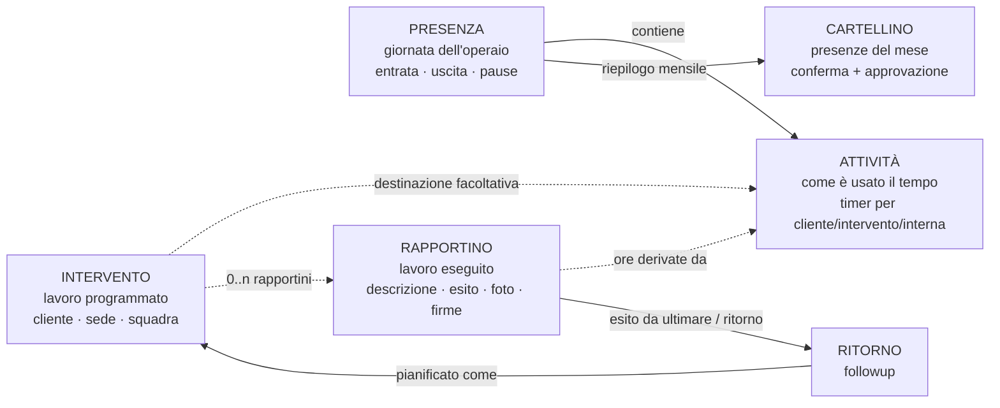

# 01 – Specifica funzionale

Gestionale per **interventi, rapportini e presenze** di una sola azienda. Fase 1: analisi, prototipo navigabile, modello dati e regole. Stato di ogni funzione: vedi §8.

## 1. Obiettivi

1. Registrare in modo affidabile la **presenza giornaliera** degli operai (entrata, uscita, pause).
2. Attribuire il tempo di presenza a **clienti, interventi e attività interne** tramite un timer, senza doppi conteggi.
3. Documentare il lavoro con **rapportini** (rapido o completo, con foto, materiali e firme) e gestire **imprevisti, lavori da ultimare e ritorni**.
4. Chiudere ogni mese con un **cartellino presenze** approvato in due passaggi (operaio → amministratore), con storico e rettifiche tracciate.
5. Funzionare **offline** sul tablet in cantiere e sincronizzare quando la rete torna.

## 2. Contesto e vincoli

| Vincolo | Decisione |
|---|---|
| Azienda | Una sola azienda, un solo archivio, più utenti |
| Ruoli | `admin` (amministratore) e `operaio` |
| Dispositivo principale | Tablet (touch, uso in cantiere, guanti, luce forte) |
| Distribuzione | PWA installabile, offline dalla progettazione |
| Registrazione ore | Ibrida: **presenza** separata dalle **attività** |
| Approvazione cartellini | Due livelli obbligatori: conferma operaio, approvazione amministratore |
| Documenti | Rapportini e cartellini **distinti e collegabili** |
| Stack di riferimento | React + TypeScript + Vite, Supabase/PostgreSQL, IndexedDB, Service Worker |

## 3. Le cinque entità che non vanno confuse

| Entità | Domanda a cui risponde | Esiste senza le altre? |
|---|---|---|
| **Presenza** | L'operaio era al lavoro? Da che ora a che ora, con quali pause? | Sì: si può essere presenti senza interventi né rapportini |
| **Attività** | Come è stato impiegato il tempo di presenza? | No: vive dentro una presenza |
| **Intervento** | Quale lavoro è programmato/richiesto, dove e con chi? | Sì: può esistere senza ore né rapportini (es. da programmare) |
| **Rapportino** | Cosa è stato fatto, con che esito, con quali materiali, chi ha firmato? | Sì: può essere autonomo (senza intervento) |
| **Cartellino** | Il riepilogo presenze del mese è corretto e approvato? | Deriva dalle presenze; è un documento a sé con stati e versioni |

Regole di cardinalità: un intervento ha **più operai** e **più rapportini** nel tempo; un rapportino può nascere da un intervento o in autonomia; un rapportino può generare un **ritorno** che resta collegato al documento originale; una presenza ha **più attività e più pause**.

## 4. Attori e permessi funzionali

| Funzione | Operaio | Amministratore |
|---|---|---|
| Timbrare entrata/uscita, pause, timer | Proprie | — (consultazione) |
| Correggere attività e orari | Proprie, mese non bloccato, con motivo | Consultazione (correzione diretta: Fase 2, D-12) |
| Imprevisti, rapportini | Propri | Consultazione di tutti |
| Anagrafiche (operai, clienti, sedi) | Lettura | Gestione |
| Programmazione interventi e squadre | Lettura dei propri | Gestione |
| Ritorni | Li genera dal rapportino | Li pianifica / annulla |
| Cartellino | Conferma o segnala discrepanza (solo il proprio) | Genera, approva, chiede correzione, rifiuta, riapre |
| Report | — | Report mensile, esportazioni |

Nota: la Fase 1 definisce i permessi **funzionali** (cosa mostra e consente l'interfaccia). L'applicazione dei permessi lato server (RLS, policy) è rinviata a una fase espressamente autorizzata (docs/03 §9).

## 5. Requisiti funzionali

### 5.1 Presenze e ore (dettaglio in docs/06)
- RF-01 Entrata e uscita con un tocco; orario dal dispositivo, correggibile con motivo.
- RF-02 Una sola giornata aperta per operaio; più presenze nello stesso giorno ammesse (rientro).
- RF-03 Pause multiple (pranzo, breve, altro); la pausa sospende il timer e propone la ripresa.
- RF-04 Timer basato su **timestamp salvati**, non su contatori: sopravvive a ricarica, chiusura del browser, spegnimento.
- RF-05 Cambio attività/cliente/intervento con un tocco: la precedente si chiude nello stesso istante.
- RF-06 Timer avviabile **senza cliente** ("da classificare"), da assegnare dopo.
- RF-07 Attività interne codificate (magazzino, manutenzione mezzi, formazione, ufficio, riunione) e trasferimenti (verso un cliente o generici).
- RF-08 Riepilogo giornaliero: lorda, pause, netta, attribuite, non attribuite, da classificare, anomalie.
- RF-09 Correzioni tracciate: modifica intervallo, cambio cliente, divisione, inserimento di un intervallo dimenticato, annullamento. L'originale resta nello storico.
- RF-10 Recupero di giornate non chiuse con uscita proposta all'ultimo segnale noto.

### 5.2 Interventi e agenda
- RF-11 Programmazione: cliente, sede (dello stesso cliente), titolo, tipo, priorità, data, ora, durata prevista.
- RF-12 Squadra con responsabile; avviso di sovrapposizione con altri impegni.
- RF-13 Agenda giorno/settimana/mese, filtro per operaio; interventi "da programmare".
- RF-14 Stati intervento: da programmare → programmato → in corso → completato | da ultimare; annullato con motivo.

### 5.3 Rapportini, imprevisti, ritorni (dettaglio in docs/09)
- RF-15 Rapportino **rapido** (descrizione, esito, foto) e **completo** (+ materiali, firma cliente e operaio).
- RF-16 Le ore del rapportino derivano dalle **attività collegate**, mai digitate.
- RF-17 Bozza solo sul dispositivo; completamento → coda di invio; numero definitivo assegnato dal server.
- RF-18 Imprevisto: tipo, gravità, descrizione, foto, "blocca il lavoro", "serve un ritorno"; collegato a presenza/intervento/rapportino.
- RF-19 Esito "da ultimare" o "serve un ritorno" crea un **followup** collegato a rapportino e intervento d'origine; l'amministratore lo pianifica come nuovo intervento di tipo ritorno; il rapportino del ritorno lo chiude.

### 5.4 Cartellini (dettaglio in docs/07)
- RF-20 Chiusura del mese → snapshot (versione) per operaio.
- RF-21 Operaio: calendario, giorni, orari, pause, ore effettive/attribuite/non attribuite, anomalie, correzioni; conferma o segnala discrepanza.
- RF-22 Amministratore: coda, differenze tra versioni e con i dati attuali, storico; approva, chiede correzione, rifiuta, riapre.
- RF-23 Ogni transizione registra utente, istante, stato precedente e nuovo, motivazione.
- RF-24 Approvato = non modificabile silenziosamente; modifiche solo via riapertura motivata → nuova versione.

### 5.5 Offline e sincronizzazione (dettaglio in docs/08)
- RF-25 Tutte le operazioni dell'operaio funzionano offline.
- RF-26 Stato visibile di ogni operazione: locale, in attesa, in sincronizzazione, sincronizzato, errore, conflitto.
- RF-27 Nessun dato dichiarato sincronizzato senza conferma del server.

### 5.6 Report (dettaglio in docs/09)
- RF-28 Report mensile per operaio e per cliente con quadratura delle ore.
- RF-29 PDF ed Excel (Fase 2), alimentati solo da dati verificati/approvati.

## 6. Requisiti non funzionali

| Area | Requisito |
|---|---|
| Usabilità tablet | Bersagli touch ≥ 48 px (azioni principali 68–88 px), testo base 16 px, max 2 tocchi per avviare/cambiare un timer |
| Feedback | Ogni azione mostra l'esito reale; i messaggi di successo compaiono solo dopo il salvataggio effettivo sul dispositivo |
| Affidabilità | Nessuna perdita di timbrature con rete assente, browser chiuso o dispositivo spento |
| Tracciabilità | Nessuna sovrascrittura di dati originali; audit di ogni modifica |
| Prestazioni | Avvio < 2 s da cache; azioni locali < 100 ms |
| Accessibilità | Contrasto AA, focus visibile, tema scuro automatico, riduzione movimento |
| Lingua | Italiano; date e ore in formato italiano; fuso Europe/Rome |

## 7. Casi limite e regole di comportamento

| Situazione | Comportamento |
|---|---|
| Operaio presente senza interventi | Normale: attività interne o "da classificare"; ore non attribuite segnalate |
| Timer attivo e avvio pausa | Il timer si chiude all'inizio della pausa; alla fine pausa si propone "Riprendi" |
| Avvio attività durante una pausa | La pausa si chiude automaticamente (un tocco per ripartire) |
| Timer dimenticato attivo all'uscita | Chiuso all'orario di uscita e marcato "chiusura automatica" |
| Giornata non chiusa (dispositivo spento) | Al riavvio blocco con proposta d'uscita = ultimo segnale/attività; conferma con motivo |
| Turno oltre mezzanotte | La presenza appartiene al giorno dell'entrata |
| Attività sovrapposte (es. da due dispositivi) | Contate una volta; il tempo comune va all'attività iniziata per ultima; anomalia |
| Attività fuori presenza o durante una pausa | Parte esclusa dal conteggio; anomalia |
| Correzione in un mese in verifica/approvato | Bloccata: serve segnalazione di discrepanza o riapertura |
| Cartellino con giornate aperte | Non generabile finché non sono chiuse |
| Conferma con dati cambiati dopo lo snapshot | Rifiutata: serve una nuova versione |
| Rapportino completo senza firma | Non completabile (salvo esito "non eseguito") |
| Esito da ultimare/ritorno senza note | Non completabile |
| Bozza di rapportino | Resta solo sul tablet, non viene inviata |
| Stesso invio ripetuto (risposta persa) | Il server lo riconosce dall'op_id e non lo applica due volte |
| Record modificato da un altro dispositivo | Conflitto: l'utente sceglie se mantenere la propria versione o quella del server |

## 8. Stato di realizzazione (Fase 1)

Legenda: **P** progettato · **I** implementato nel prototipo · **S** simulato (dati locali/server simulato) · **V** verificato con test eseguiti · **N** non ancora realizzato.

| Funzione | Stato |
|---|---|
| Presenza, pause, timer, cambio cliente, attività interne/trasferimenti | P · I · V |
| Motore ore (unione intervalli, anomalie, mezzanotte, ora legale) | P · I · V |
| Correzioni (modifica, divisione, aggiunta, annullamento) con storico | P · I · V |
| Recupero giornata non chiusa / timer dopo riapertura | P · I · V |
| Interventi, agenda, squadre, anagrafiche | P · I (verifica manuale + E2E parziale) |
| Rapportini rapido/completo, foto, firme, materiali | P · I · V (foto/firma solo verifica manuale) |
| Imprevisti e ritorni collegati | P · I · V |
| Cartellino: stati, versioni, approvazioni, riapertura | P · I · V |
| Offline e sincronizzazione | P · S · V (server **simulato**) |
| Autenticazione | S (accesso dimostrativo, nessuna sicurezza) |
| Schema PostgreSQL con vincoli e trigger | P · V (su PostgreSQL 16 locale, mai su DB remoto) |
| PDF/Excel | P · N (solo anteprima CSV nel report) |
| Backend Supabase reale, RLS, notifiche | N |
