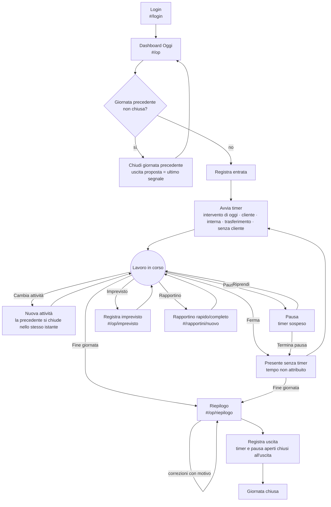
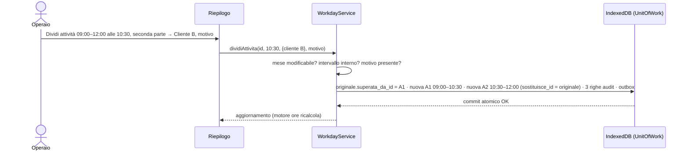
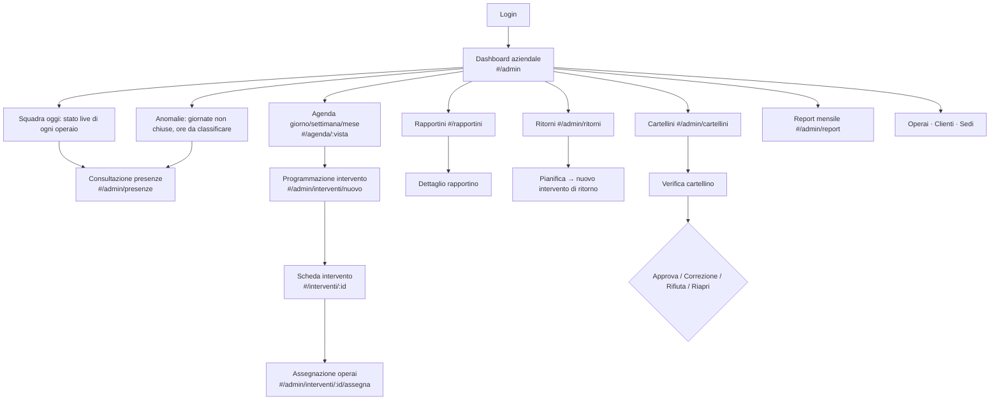
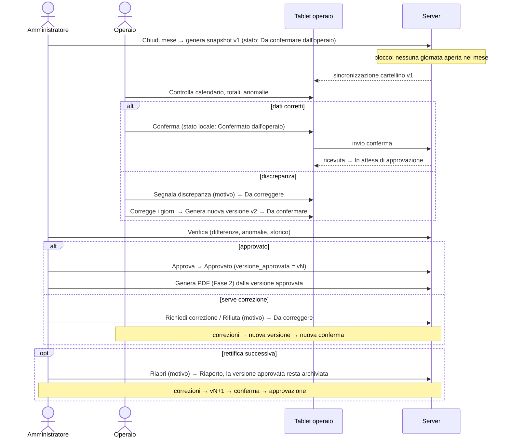
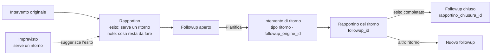

# 02 – Flussi operativi

Per ogni flusso: passi, schermata del prototipo (`#/percorso`), regole e casi limite. I diagrammi sono Mermaid.

## 1. Flusso operaio

### 1.1 Giornata tipo

### 1.2 Passi e regole

| Passo | Schermata | Regole |
|---|---|---|
| Login | `#/login` | Prototipo: account demo con un tocco (password `demo`). Fase 2: Supabase Auth, sessione persistente per uso offline |
| Dashboard | `#/op` | Stato giornata in evidenza (card grande), timer in secondi, totali del giorno, azioni rapide, interventi di oggi con "Avvia" diretto |
| Inizio giornata / Entrata | `#/op`, `#/op/presenza` | Blocca se esiste una giornata aperta; non accetta orari futuri; la data lavoro è quella dell'entrata |
| Avvio timer | `#/op/timer` | Un tocco su un intervento di oggi = cliente+sede+intervento; altrimenti cliente (+sede, +intervento facoltativo), interna, trasferimento, senza cliente. Se c'è una pausa aperta viene chiusa |
| Cambio cliente / intervento | `#/op/timer` | "Cambia e avvia": chiusura della precedente e apertura della nuova con lo stesso timestamp |
| Pausa | `#/op/pause` o pulsante Pausa | Una sola pausa aperta; il timer si chiude all'inizio pausa e viene ricordato (`attivita_sospesa_id`) |
| Ripresa | card pausa | "Riprendi X" chiude la pausa e crea una NUOVA attività con la stessa destinazione |
| Imprevisto | `#/op/imprevisto` | Tipo + descrizione obbligatori; intervento predefinito = quello del timer in corso; foto facoltative |
| Rapportino | `#/rapportini/nuovo` | Da intervento: si apre già collegato; autonomo: scelta cliente. Le attività del giorno compatibili sono collegate in automatico |
| Fine giornata | `#/op/riepilogo` | Conferma con riepilogo e avvisi (timer attivo, pausa aperta, ore da classificare) |
| Riepilogo ore | `#/op/riepilogo?data=` | Totali, linea del tempo, ripartizione, anomalie, documenti del giorno; navigazione tra i giorni |
| Correzione attività | `#/op/riepilogo` | Correggi, Dividi, Annulla, Aggiungi; motivo obbligatorio; vietate sovrapposizioni e intervalli fuori presenza; mese bloccato se cartellino in verifica |

### 1.3 Correzione di un'attività

## 2. Flusso amministratore

| Funzione | Schermata | Regole principali |
|---|---|---|
| Dashboard | `#/admin` | KPI del giorno; squadra con timer live; "Da fare": cartellini da approvare, ritorni da pianificare; anomalie |
| Gestione operai | `#/admin/operai` | Email univoca; disattivazione invece di cancellazione |
| Gestione clienti | `#/admin/clienti`, `#/admin/clienti/:id` | P.IVA 11 cifre univoca; scheda con sedi, interventi, ore registrate |
| Gestione sedi | `#/admin/sedi` | Sede sempre legata a un cliente; note di accesso visibili agli operai |
| Programmazione | `#/admin/interventi/nuovo` | Senza data = "da programmare"; sede del cliente scelto; squadra opzionale |
| Assegnazione | `#/admin/interventi/:id/assegna` | Un responsabile; avviso (non blocco) per sovrapposizioni; rimozioni come eliminazione logica |
| Agenda | `#/agenda/giorno|settimana|mese` | Filtro operaio; ritorni evidenziati |
| Consultazione presenze | `#/admin/presenze?data&operaio` | Tabella del giorno e dettaglio con storico correzioni (sola lettura) |
| Consultazione rapportini | `#/rapportini` | Filtri, ricerca; le bozze altrui non sono visibili (restano sul tablet) |
| Verifica anomalie | Dashboard, presenze, cartellino | Anomalie calcolate dal motore (docs/06 §6) |
| Approvazione cartellini | `#/admin/cartellini/:id` | Azioni disponibili solo se ammesse dallo stato (docs/07) |

## 3. Flusso mensile

Stati e transizioni complete: docs/07.

## 4. Flusso rapportino → ritorno

La catena è navigabile in entrambe le direzioni dal dettaglio del rapportino, dalla scheda intervento e dalla pagina Ritorni.

## 5. Casi limite trasversali

| Caso | Comportamento progettato | Nel prototipo |
|---|---|---|
| Browser chiuso con timer attivo | Riaprendo, il timer mostra il tempo corretto (calcolato da `inizio_at`) | Verificato (E2E reload, T06) |
| Dispositivo spento a fine giornata | Banner bloccante il giorno dopo con uscita proposta | Verificato (T07) |
| Rete assente tutto il giorno | Tutto salvato in IndexedDB, coda visibile, invio al ritorno della rete | Verificato con rete simulata (T24, E2E offline) |
| Due tablet per lo stesso operaio | Attività sovrapposte contate una volta + anomalia; conflitti su stessi record risolti dall'utente | Motore verificato (E3); conflitto simulato (T27) |
| Amministratore modifica un intervento mentre l'operaio è offline | Ultima scrittura vince sui campi descrittivi; stato intervento ricalcolato dal server (docs/08 §6) | Progettato |
| Operaio cambia dispositivo | I dati non sincronizzati restano sul vecchio dispositivo: avviso nella pagina Sync | Progettato (D-10) |
