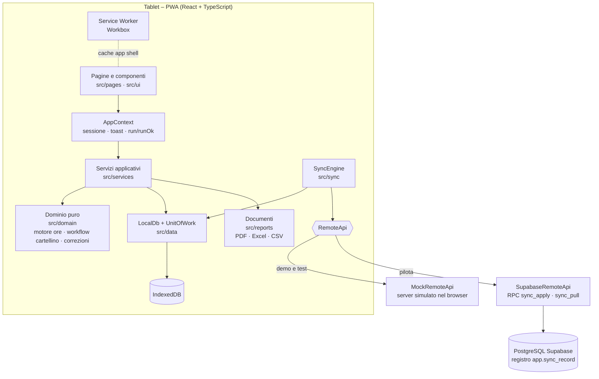
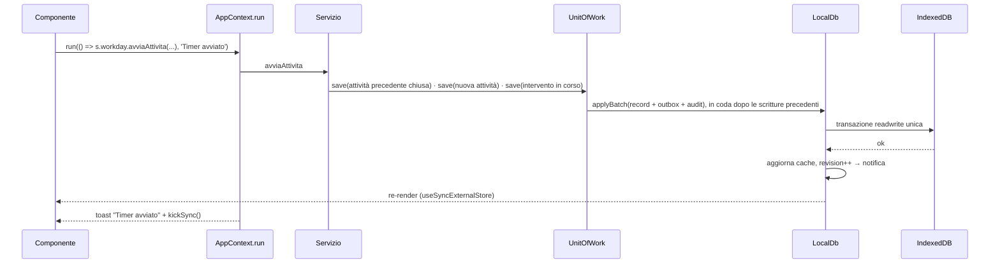

# 03 – Architettura applicativa

## 1. Visione d'insieme



Principi:

1. **Offline-first**: la UI legge e scrive solo sul database locale; la rete serve solo alla sincronizzazione.
2. **Dominio puro e testabile**: calcolo ore, transizioni del cartellino, pianificazione delle correzioni sono funzioni senza I/O, con l'orologio passato come parametro.
3. **Nessun accesso ai dati dai componenti**: i componenti chiamano i servizi; nessuna query sparsa.
4. **Atomicità**: ogni operazione utente è una `UnitOfWork` che scrive in un'unica transazione IndexedDB record + coda di sincronizzazione + audit.
5. **Verità sul server**: numerazioni definitive, ricezione delle conferme e risoluzione dei conflitti sono decise dal server.

## 2. Struttura delle cartelle e regole di dipendenza

```
prototype/
├── index.html, vite.config.ts, playwright.config.ts, tsconfig.json, .env.*.example
├── public/                      icone, sw-notifiche.js
├── scripts/genera-esempi-pdf.ts PDF di esempio dai dati demo
├── src/
│   ├── main.tsx                 avvio: configurazione, IndexedDB, dati demo, Service Worker
│   ├── app/                     App (router e protezioni per ruolo), AppShell (layout), AppContext, pwa
│   ├── config/                  ambiente (variabili VITE_*), accesso (username/PIN), dati azienda
│   ├── shared/errors.ts         AppError e messaggi d'errore (usato da tutti i livelli)
│   ├── domain/                  LOGICA PURA – nessuna dipendenza da React, storage o rete
│   │   ├── types.ts             modello dati (specchio dello schema SQL)
│   │   ├── intervals.ts, time.ts, ids.ts
│   │   ├── hours-engine.ts      motore ore (docs/06)
│   │   ├── day-records.ts       record → motore, snapshot mensile, pianificazione correzioni
│   │   ├── timesheet-workflow.ts macchina a stati del cartellino (docs/07)
│   │   ├── magazzino.ts, stato-presenza.ts
│   ├── data/                    PERSISTENZA LOCALE
│   │   ├── storage.ts           adattatori IndexedDB / memoria (stesso contratto)
│   │   ├── local-db.ts          cache + coda di scrittura + UnitOfWork + outbox + audit
│   │   └── demo-seed.ts         dati dimostrativi (deterministici)
│   ├── sync/                    SINCRONIZZAZIONE E BACKEND
│   │   ├── sync-engine.ts       invio della coda, ricezione, backoff, conflitti
│   │   ├── remote-api.ts        contratto del backend (applica, ricevi)
│   │   ├── mock-remote-api.ts   server SIMULATO (demo e test)
│   │   ├── supabase-remote-api.ts RPC sync_apply / sync_pull
│   │   └── auth-supabase.ts     Supabase Auth (username+PIN), profilo, accesso offline
│   ├── services/                CASI D'USO (unico accesso ai dati per la UI)
│   │   ├── app-services.ts      contenitore, sessione, simulazione rete, dati demo
│   │   ├── base.ts              contesto, permessi per ruolo, blocco mese, nome profilo
│   │   ├── workday, timesheet, report, planning, magazzino, storico, analisi, notifiche,
│   │   │   riepiloghi, richieste (*-service.ts)
│   ├── reports/                 DOCUMENTI: modello riepiloghi, layout e servizio PDF, Excel, CSV
│   ├── ui/                      componenti riusabili (Card, Sheet, DayDetail, FirmaSchermoIntero,
│   │                            CorreggiPresenzaSheet, …) e styles.css
│   └── pages/                   schermate: operaio/, admin/, shared/ (rapportino/ = editor del rapporto), Login
└── tests/
    ├── unit/                    Vitest: dominio, servizi, sincronizzazione, PDF su storage in memoria
    └── e2e/                     Playwright: tablet e iPhone sul prototipo compilato
```

Dipendenze ammesse (verificate sul codice il 26/11/2026 con uno script sugli import: nessuna eccezione):

| Modulo | Può importare |
|---|---|
| `domain` | solo `domain` |
| `shared`, `config` | niente del progetto (`config` solo sé stesso) |
| `data` | `domain`, `shared` |
| `sync` | `domain`, `data`, `shared`, `config` |
| `reports` | `domain`, `shared`, `config` |
| `services` | tutti i precedenti |
| `ui` | `domain`, `services`, `reports`, `app`, `shared`, `config` |
| `pages` | `ui`, `services`, `domain`, `reports`, `app`, `shared`, `config` – **mai** `data` o `sync` |
| `app` | come `pages`, più `pages` (router) |

## 3. Responsabilità e contratti dei servizi

| Servizio | Responsabilità | Metodi principali | Errori tipici |
|---|---|---|---|
| `WorkdayService` | Giornata dell'operaio | `registraEntrata`, `registraUscita`, `iniziaPausa`, `terminaPausa`, `avviaAttivita`, `fermaAttivita`, `riprendiAttivita`, `classificaInCorso`, `correggiAttivita`, `dividiAttivita`, `aggiungiAttivita`, `annullaAttivita`, `correggiPresenza`, `segnale`, `giornataNonChiusa`, `riepilogo` | `STATO_NON_VALIDO` (già aperta, nessun timer), `VALIDAZIONE` (orari, sovrapposizioni, motivo), `MESE_BLOCCATO` |
| `TimesheetService` | Cartellino mensile | `genera`, `chiudiMese`, `conferma`, `segnalaDiscrepanza`, `approva`, `richiediCorrezione`, `rifiuta`, `riapri`, `rigenera`, `anteprima`, `versioni`, `storico` | `STATO_NON_VALIDO` (transizione non ammessa, giornate aperte, dati cambiati), `NON_CONSENTITO` |
| `ReportService` | Documentazione del lavoro | `creaBozza`, `salvaBozza`, `validaCompletamento`, `completa`, `oreRapportino`, `catena`, `registraImprevisto`, `aggiungiAllegato`, `pianificaRitorno`, `annullaFollowup` | `VALIDAZIONE`, `STATO_NON_VALIDO` |
| `PlanningService` | Pianificazione e anagrafiche | `creaIntervento`, `aggiornaIntervento`, `cambiaStatoIntervento`, `assegnaOperai`, `conflittiAssegnazione`, `salvaCliente`, `salvaSede`, `salvaOperaio` | `VALIDAZIONE`, `NON_CONSENTITO` |
| `StoricoService` | Storico amministrativo ed esportazioni (Fase 14) | `escludi`, `includi`, `archivia`, `ripristina`, `eliminaDefinitivamente`, `modello`, `documento`, `esporta`, `registroOperazioni` | `NON_CONSENTITO` (solo amministratore), `VALIDAZIONE` (motivo) |
| `MagazzinoService`, `AnalisiService`, `NotificheService`, `RiepiloghiService`, `RichiesteService` | Magazzino e costi, report aziendali, notifiche, dati dei PDF, richieste di correzione | vedi docs/14–16 | `VALIDAZIONE`, `NON_CONSENTITO` |
| `SyncEngine` | Invio della coda e ricezione | `ciclo`, `pendenti`, `risolviMantieniLocale`, `risolviAccettaServer`, `pulisciSincronizzate` | Non lancia: registra lo stato su ogni operazione |
| `RemoteApi` | Contratto backend | `applica(RichiestaSync) → RispostaSync`, `ricevi(dopo) → PaginaRemota` (facoltativo) | `ErroreRete`, `ErroreServer` |

Regole comuni: ogni metodo di scrittura (1) verifica sessione e ruolo, (2) valida con funzioni del dominio, (3) costruisce una `UnitOfWork`, (4) `commit()` atomico. La UI usa `run()` / `runOk()` di `AppContext`, che mostrano il messaggio di successo **solo dopo** il commit e altrimenti il messaggio d'errore.

## 4. Gestione degli errori

- Un unico tipo `AppError { codice, messaggio, dettaglio }` (`src/shared/errors.ts`); codici: `VALIDAZIONE`, `STATO_NON_VALIDO`, `NON_TROVATO`, `NON_CONSENTITO`, `MESE_BLOCCATO`, `PERSISTENZA`, `RETE`, `SERVER`, `CONFLITTO`, `SENZA_PRESENZA`.
- `messaggio` è sempre in italiano e pensato per l'utente finale; `dettaglio` va in console/log.
- Le eccezioni di validazione del dominio (`ErroreValidazione`) sono tradotte in `AppError('VALIDAZIONE')`.
- Errori di scrittura locale → `PERSISTENZA`: la cache non viene aggiornata (test T28).
- Gli errori di sincronizzazione non interrompono l'uso: diventano stato dell'operazione (docs/08).

## 5. Flusso dati di una scrittura



## 6. Convenzioni di codice

- TypeScript `strict`, nessun `any` nel dominio; nomi di dominio in italiano (coerenti con le tabelle SQL), nomi tecnici in inglese dove standard (`storage`, `outbox`).
- File: `kebab-case.ts` per moduli, `PascalCase.tsx` per componenti/pagine.
- Date: istanti in UTC ISO (`*_at`), giorni di calendario `YYYY-MM-DD` (`data_*`), ore `HH:MM`. Le durate non si salvano mai: si calcolano.
- Ogni modifica passa da un servizio; pagine e componenti non importano `data/` né `sync/` (regole al §2).
- Le scritture su `LocalDb` sono in coda: una parte solo quando la precedente è nel database e nella cache. Un batch che dipende dallo stato attuale (esito del server, decisione di accodare) si passa come funzione, valutata al momento della scrittura (D-50).
- Componenti UI senza logica di business; pagine sottili che compongono componenti e chiamano servizi.
- `data-testid` sugli elementi usati dai test E2E.
- Nessuna credenziale nel repository; configurazione futura via variabili `VITE_SUPABASE_URL` / `VITE_SUPABASE_ANON_KEY` in `.env.local` (ignorato da git).

## 7. Scelte tecnologiche

| Area | Scelta | Motivo |
|---|---|---|
| UI | React 18 + TypeScript 5.6 + Vite 5 | Richiesto; versioni consolidate |
| Componenti | **Design system proprio** (CSS con variabili, ~600 righe) + icone `lucide-react` | Leggero, nessun vincolo di libreria, controllo totale su dimensioni touch e contrasto. Alternativa valutata: Mantine/MUI (più pesanti) – vedi D-03 |
| Routing | `react-router-dom` 6 con `HashRouter` | Funziona da qualsiasi percorso statico e offline |
| Persistenza locale | IndexedDB via `idb` 8 | API a promesse minimale, transazioni multi-store |
| PWA | `vite-plugin-pwa` (Workbox `generateSW`) | Precache dell'app shell, aggiornamento controllato |
| Test | Vitest 2 + Playwright 1.63 | Unit veloci su storage in memoria + E2E su Chromium |
| PDF | `pdfmake` 0.2.20 lato client, import dinamico | docs/13 |
| Excel | Scritto in proprio (`src/reports/xlsx.ts`, Office Open XML) | Nessuna dipendenza aggiuntiva (D-36) |

## 8. Backend Supabase (stato reale)

Realizzato (Fasi 12–15, docs/17 §5–6):

1. Accesso con nome utente e PIN su Supabase Auth (`src/sync/auth-supabase.ts`), profilo con la RPC `mio_profilo`, accesso senza rete dopo il primo accesso.
2. `SupabaseRemoteApi` con lo stesso contratto del server simulato: `sync_apply` (idempotenza per `op_id`, versioni, numerazione, regole per ruolo) e `sync_pull` (ricezione incrementale per utente), su un registro di record JSON `app.sync_record` (D-49).

Non realizzato:

1. Proiezione dei record sincronizzati nelle tabelle normalizzate (reportistica lato server).
2. Bucket di Storage per foto e firme (oggi nel record dell'allegato).
3. Creazione degli account dall'app (serve una funzione lato server).

## 9. Requisiti architetturali di sicurezza (solo documentati, NON verificati in Fase 1)

Da realizzare e verificare in una fase espressamente autorizzata:

- Autenticazione Supabase Auth; `profili.id = auth.users.id`; sessione persistente per l'uso offline con scadenza e rinnovo.
- Nessuna tabella esposta direttamente: accesso solo tramite RPC `security definer` con controllo del ruolo e della titolarità (operaio → propri dati).
- Row Level Security abilitata su tutte le tabelle dello schema `app` come seconda barriera.
- Bucket Storage privato, URL firmati a scadenza breve.
- Dati sul dispositivo: valutare cifratura e cancellazione al logout; gestione del tablet condiviso.
- Registro audit non modificabile (già previsto dai trigger `solo_inserimento`).
- Segreti solo in variabili d'ambiente / secret manager, mai nel codice.
