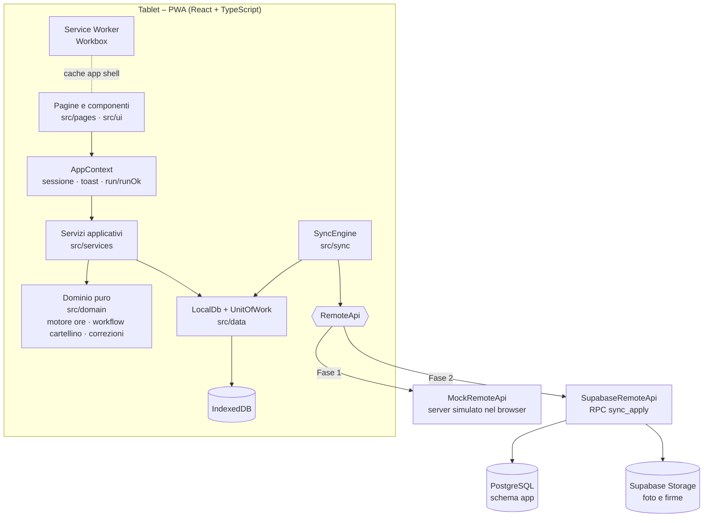
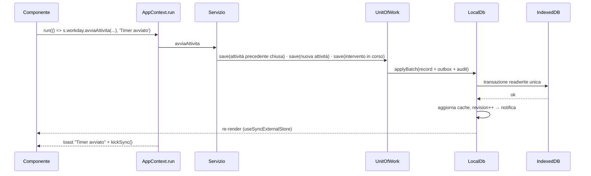

# 03 – Architettura applicativa

## 1. Visione d'insieme



Principi:

1. **Offline-first**: la UI legge e scrive solo sul database locale; la rete serve solo alla sincronizzazione.
2. **Dominio puro e testabile**: calcolo ore, transizioni del cartellino, pianificazione delle correzioni sono funzioni senza I/O, con l'orologio passato come parametro.
3. **Nessun accesso ai dati dai componenti**: i componenti chiamano i servizi; nessuna query sparsa.
4. **Atomicità**: ogni operazione utente è una `UnitOfWork` che scrive in un'unica transazione IndexedDB record + coda di sincronizzazione + audit.
5. **Verità sul server**: numerazioni definitive, ricezione delle conferme e risoluzione dei conflitti sono decise dal server.

## 2. Struttura delle cartelle (prototipo)

```
prototype/
├── index.html, vite.config.ts, playwright.config.ts, tsconfig.json
├── public/icon.svg
├── src/
│   ├── main.tsx                 avvio: IndexedDB, seed demo, registrazione Service Worker
│   ├── app/                     App (router), AppShell (layout), AppContext (stato condiviso)
│   ├── domain/                  LOGICA PURA – nessuna dipendenza da React o storage
│   │   ├── types.ts             modello dati (specchio dello schema SQL)
│   │   ├── intervals.ts         algebra degli intervalli
│   │   ├── hours-engine.ts      motore ore (docs/06)
│   │   ├── day-records.ts       record → motore, snapshot mensile, pianificazione correzioni
│   │   ├── timesheet-workflow.ts macchina a stati del cartellino (docs/07)
│   │   ├── time.ts, ids.ts      date locali, UUID v4, impronta
│   ├── data/                    PERSISTENZA LOCALE
│   │   ├── storage.ts           adattatori IndexedDB / memoria (stesso contratto)
│   │   ├── local-db.ts          cache + UnitOfWork + outbox + audit
│   │   └── demo-seed.ts         dati dimostrativi (deterministici)
│   ├── sync/                    SINCRONIZZAZIONE
│   │   ├── remote-api.ts        contratto del backend
│   │   ├── mock-remote-api.ts   server SIMULATO (solo prototipo)
│   │   └── sync-engine.ts       outbox, retry, backoff, conflitti
│   ├── reports/                 DOCUMENTI (Fase 2): modello riepiloghi, layout PDF, servizio PDF, formattazione
│   ├── config/                  dati dell'azienda per i documenti
│   ├── services/                LOGICA APPLICATIVA (casi d'uso)
│   │   ├── app-services.ts      contenitore, sessione simulata, simulazione rete
│   │   ├── workday-service.ts   presenza, pause, timer, correzioni, recupero
│   │   ├── timesheet-service.ts cartellini, versioni, approvazioni
│   │   ├── report-service.ts    rapportini, allegati, imprevisti, ritorni
│   │   ├── planning-service.ts  anagrafiche, interventi, squadre
│   │   ├── riepiloghi-service.ts recupero dati per i riepiloghi PDF (Fase 2)
│   │   ├── base.ts, errors.ts   contesto, blocco mese, errori uniformi
│   ├── ui/                      componenti riusabili (Card, Sheet, Badge, DayDetail, DestinationPicker, CartellinoView…) e styles.css
│   └── pages/                   schermate: operaio/, admin/, shared/, Login
└── tests/
    ├── unit/                    Vitest: dominio e servizi su storage in memoria
    └── e2e/                     Playwright: simulazione completa nel browser
```

## 3. Responsabilità e contratti dei servizi

| Servizio | Responsabilità | Metodi principali | Errori tipici |
|---|---|---|---|
| `WorkdayService` | Giornata dell'operaio | `registraEntrata`, `registraUscita`, `iniziaPausa`, `terminaPausa`, `avviaAttivita`, `fermaAttivita`, `riprendiAttivita`, `classificaInCorso`, `correggiAttivita`, `dividiAttivita`, `aggiungiAttivita`, `annullaAttivita`, `correggiPresenza`, `segnale`, `giornataNonChiusa`, `riepilogo` | `STATO_NON_VALIDO` (già aperta, nessun timer), `VALIDAZIONE` (orari, sovrapposizioni, motivo), `MESE_BLOCCATO` |
| `TimesheetService` | Cartellino mensile | `genera`, `chiudiMese`, `conferma`, `segnalaDiscrepanza`, `approva`, `richiediCorrezione`, `rifiuta`, `riapri`, `rigenera`, `anteprima`, `versioni`, `storico` | `STATO_NON_VALIDO` (transizione non ammessa, giornate aperte, dati cambiati), `NON_CONSENTITO` |
| `ReportService` | Documentazione del lavoro | `creaBozza`, `salvaBozza`, `validaCompletamento`, `completa`, `oreRapportino`, `catena`, `registraImprevisto`, `aggiungiAllegato`, `pianificaRitorno`, `annullaFollowup` | `VALIDAZIONE`, `STATO_NON_VALIDO` |
| `PlanningService` | Pianificazione e anagrafiche | `creaIntervento`, `aggiornaIntervento`, `cambiaStatoIntervento`, `assegnaOperai`, `conflittiAssegnazione`, `salvaCliente`, `salvaSede`, `salvaOperaio` | `VALIDAZIONE`, `NON_CONSENTITO` |
| `SyncEngine` | Invio della coda | `ciclo`, `pendenti`, `risolviMantieniLocale`, `risolviAccettaServer`, `pulisciSincronizzate` | Non lancia: registra lo stato su ogni operazione |
| `RemoteApi` | Contratto backend | `applica(RichiestaSync) → RispostaSync` | `ErroreRete`, `ErroreServer` |

Regole comuni: ogni metodo di scrittura (1) verifica sessione e ruolo, (2) valida con funzioni del dominio, (3) costruisce una `UnitOfWork`, (4) `commit()` atomico. La UI usa `run()` / `runOk()` di `AppContext`, che mostrano il messaggio di successo **solo dopo** il commit e altrimenti il messaggio d'errore.

## 4. Gestione degli errori

- Un unico tipo `AppError { codice, messaggio, dettaglio }` (`src/services/errors.ts`); codici: `VALIDAZIONE`, `STATO_NON_VALIDO`, `NON_TROVATO`, `NON_CONSENTITO`, `MESE_BLOCCATO`, `PERSISTENZA`, `RETE`, `SERVER`, `CONFLITTO`.
- `messaggio` è sempre in italiano e pensato per l'utente finale; `dettaglio` va in console/log.
- Le eccezioni di validazione del dominio (`ErroreValidazione`) sono tradotte in `AppError('VALIDAZIONE')`.
- Errori di scrittura locale → `PERSISTENZA`: la cache non viene aggiornata (test T28).
- Gli errori di sincronizzazione non interrompono l'uso: diventano stato dell'operazione (docs/08).

## 5. Flusso dati di una scrittura



## 6. Convenzioni di codice

- TypeScript `strict`, nessun `any` nel dominio; nomi di dominio in italiano (coerenti con le tabelle SQL), nomi tecnici in inglese dove standard (`storage`, `outbox`).
- File: `kebab-case.ts` per moduli, `PascalCase.tsx` per componenti/pagine.
- Date: istanti in UTC ISO (`*_at`), giorni di calendario `YYYY-MM-DD` (`data_*`), ore `HH:MM`. Le durate non si salvano mai: si calcolano.
- Ogni modifica passa da un servizio; i componenti non importano `data/` né `sync/`.
- Componenti UI senza logica di business; pagine sottili che compongono componenti e chiamano servizi.
- `data-testid` sugli elementi usati dai test E2E.
- Nessuna credenziale nel repository; configurazione futura via variabili `VITE_SUPABASE_URL` / `VITE_SUPABASE_ANON_KEY` in `.env.local` (ignorato da git).

## 7. Scelte tecnologiche

| Area | Scelta | Motivo |
|---|---|---|
| UI | React 18 + TypeScript 5.6 + Vite 5 | Richiesto; versioni consolidate |
| Componenti | **Design system proprio** (CSS con variabili, ~600 righe) + icone `lucide-react` | Leggero, nessun vincolo di libreria, controllo totale su dimensioni touch e contrasto. Alternativa valutata: Mantine/MUI (più pesanti) – vedi D-03 |
| Routing | `react-router-dom` 6 con `HashRouter` | Funziona da qualsiasi percorso statico e offline |
| Persistenza locale | IndexedDB via `idb` 8 | API a promesse minimale, transazioni multi-store |
| PWA | `vite-plugin-pwa` (Workbox `generateSW`) | Precache dell'app shell, aggiornamento controllato |
| Test | Vitest 2 + Playwright 1.63 | Unit veloci su storage in memoria + E2E su Chromium |
| PDF | `pdfmake` 0.2.20 lato client, import dinamico | docs/13 |
| Excel (Fase 2) | `exceljs` | Formati, formule e fogli multipli; licenza MIT |

## 8. Passaggio a Supabase (Fase 2)

1. Implementare `SupabaseRemoteApi` con lo stesso contratto di `RemoteApi`, chiamando una RPC `app.sync_apply(op jsonb)` che: verifica `op_id` in `sync_operazioni`, confronta `row_version`, applica la scrittura e le regole lato server, registra audit e risposta, tutto in una transazione.
2. Download incrementale (`updated_at > ultimo_sync`) per tabella, con paginazione.
3. Upload allegati su Storage prima dell'operazione che li referenzia (docs/08 §7).
4. Sostituire la sessione simulata con Supabase Auth.

## 9. Requisiti architetturali di sicurezza (solo documentati, NON verificati in Fase 1)

Da realizzare e verificare in una fase espressamente autorizzata:

- Autenticazione Supabase Auth; `profili.id = auth.users.id`; sessione persistente per l'uso offline con scadenza e rinnovo.
- Nessuna tabella esposta direttamente: accesso solo tramite RPC `security definer` con controllo del ruolo e della titolarità (operaio → propri dati).
- Row Level Security abilitata su tutte le tabelle dello schema `app` come seconda barriera.
- Bucket Storage privato, URL firmati a scadenza breve.
- Dati sul dispositivo: valutare cifratura e cancellazione al logout; gestione del tablet condiviso.
- Registro audit non modificabile (già previsto dai trigger `solo_inserimento`).
- Segreti solo in variabili d'ambiente / secret manager, mai nel codice.
