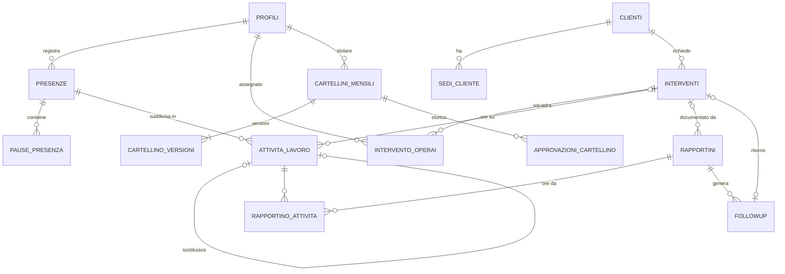

# 04 – Modello dati

File di riferimento:

- `database/migrations/0001…0007_*.sql` – migrazioni (fonte unica), **solo preparate, mai applicate a DB remoti**
- `database/schema.sql` – concatenazione generata da `database/build-schema.sh`
- `database/er-diagram.mmd` – diagramma ER completo
- `database/tests/verifica_regole.sql` – 28 verifiche delle regole eseguite su PostgreSQL 16 locale
- `docs/05-dizionario-dati.md` – dizionario generato dal catalogo del database

## 1. Panoramica delle tabelle

| Area | Tabella | Ruolo |
|---|---|---|
| Anagrafiche | `profili` | Utenti (admin, operai) |
| | `clienti`, `sedi_cliente` | Clienti e sedi operative |
| Pianificazione | `interventi` | Lavori programmati o richiesti |
| | `intervento_operai` | Squadra (N operai per intervento) |
| Ore | `presenze` | Giornata: entrata, uscita, valori originali, ultimo segnale |
| | `pause_presenza` | Pause della presenza |
| | `attivita_lavoro` | Intervalli di tempo attribuiti; catena di correzioni |
| | `imprevisti` | Problemi segnalati in cantiere |
| Documenti | `rapportini` | Lavoro eseguito (autonomo o da intervento, o da ritorno) |
| | `rapportino_operai`, `rapportino_attivita` | Operai presenti; attività da cui derivano le ore |
| | `rapportino_materiali`, `rapportino_foto`, `rapportino_firme` | Contenuti del rapportino |
| | `allegati`, `imprevisto_allegati` | Metadati dei file (contenuto su Storage) |
| | `followup` | Ritorni e lavori da ultimare |
| Cartellini | `cartellini_mensili` | Testata mensile con stato e versioni |
| | `cartellino_versioni` | Snapshot immutabili |
| | `approvazioni_cartellino` | Registro append-only delle transizioni |
| | `transizioni_cartellino` | Regole delle transizioni (dati di configurazione) |
| Tecniche | `audit_log` | Prima/dopo di ogni modifica, append-only |
| | `dispositivi`, `sync_operazioni` | Dispositivi e registro di idempotenza |
| | `contatori_documenti` | Numerazioni definitive lato server |

## 2. Diagramma ER (sintesi)

Il diagramma completo con gli attributi è in `database/er-diagram.mmd`.

## 3. Relazioni richieste e come sono modellate

| Requisito | Modellazione |
|---|---|
| Interventi con più operai | `intervento_operai` (unico per intervento+operaio tra le righe attive; un solo responsabile) |
| Presenze indipendenti dai rapportini | Nessuna FK tra `presenze` e `rapportini`; il legame è indiretto e facoltativo via `rapportino_attivita` |
| Più attività nella stessa giornata | `attivita_lavoro.presenza_id` (N:1); un solo timer aperto per operaio (indice unico parziale) |
| Rapportini collegati agli interventi | `rapportini.intervento_id` facoltativo; un intervento ha N rapportini |
| Rapportini autonomi | `intervento_id` nullo, `cliente_id` obbligatorio |
| Ritorni collegati al rapportino originale | `followup.rapportino_origine_id` (obbligatorio) → `followup.intervento_ritorno_id` → `interventi.followup_origine_id` → `rapportini.followup_id`; chiusura in `followup.rapportino_chiusura_id` |
| Cartellini mensili | `cartellini_mensili` unico per operaio/anno/mese |
| Approvazioni e revisioni | `cartellino_versioni` (immutabili) + `approvazioni_cartellino` (append-only, FK alla regola in `transizioni_cartellino` e alla versione) |

Coerenza sede/cliente: `sedi_cliente` espone `unique (id, cliente_id)` e le tabelle che referenziano una sede usano una FK composta `(sede_id, cliente_id)`, così non è possibile associare una sede di un altro cliente.

## 4. Identificativi generati sul dispositivo

- Tutte le chiavi primarie sono **UUID v4 generati dal client** (`crypto.randomUUID()` con fallback). Il `default gen_random_uuid()` lato DB è solo una riserva per inserimenti amministrativi.
- Conseguenze: un record creato offline ha già il suo id definitivo; le FK tra record creati offline (presenza → attività → rapportino → foto) sono valide prima della sincronizzazione; nessuna rimappatura di id.
- I **numeri leggibili** (rapportino `R-AAAA-NNNN`, intervento `INT-AAAA-NNN`) non sono chiavi: il dispositivo usa un numero provvisorio univoco per dispositivo (`numero_provvisorio`, unico con `device_id`), il server assegna quello definitivo con `app.prossimo_numero()`.

## 5. Idempotenza

- Ogni operazione di sincronizzazione ha un `op_id` UUID generato sul dispositivo e **riusato identico in ogni ritentativo** insieme allo stesso payload.
- Il server registra l'esito in `sync_operazioni` (PK = `op_id`, tabella append-only) nella stessa transazione della scrittura: se la risposta si perde e il client ritenta, il server restituisce la risposta memorizzata senza riapplicare nulla (verificato: T26 e verifica SQL "stessa operazione applicata due volte").
- Gli inserimenti sono comunque idempotenti per natura (PK = UUID del client): un secondo insert dello stesso id fallisce invece di duplicare.

## 6. Concorrenza: `row_version`

- Ogni tabella sincronizzabile ha `row_version` incrementata dal trigger `tg_aggiorna_metadati` a ogni UPDATE.
- Il client invia `base_versione` = ultima versione confermata; il server applica l'aggiornamento solo se coincide, altrimenti risponde `conflitto` con la versione e i dati correnti (docs/08 §6).
- Nota di progetto: nel prototipo il campo si chiamava inizialmente `versione` e collideva con il numero di versione del cartellino; è stato rinominato `row_version` per separare il concetto tecnico da quello di dominio.

## 7. Campi di creazione/modifica e regole di aggiornamento

| Colonna | Regola |
|---|---|
| `created_at`, `created_by` | Impostati all'inserimento, resi immutabili dal trigger |
| `updated_at`, `updated_by` | `updated_at` dal trigger; `updated_by` dalla RPC (utente autenticato) |
| `row_version` | +1 a ogni UPDATE (trigger) |
| `device_id`, `client_created_at` | Dal dispositivo; usati per diagnosi e per l'unicità dei numeri provvisori |
| `deleted_at` | Eliminazione logica. La cancellazione fisica è impedita dal trigger `tg_no_delete_fisico` |

Tabelle **append-only** (UPDATE/DELETE vietati da trigger): `audit_log`, `approvazioni_cartellino`, `cartellino_versioni`, `sync_operazioni`, `transizioni_cartellino` (modificabile solo in migrazione).

## 8. Vincoli temporali

| Vincolo | Dove |
|---|---|
| `uscita_at > entrata_at`, durata ≤ 24 h | `presenze` (check) |
| `data_lavoro` = giorno locale (Europe/Rome) dell'entrata | `presenze_data_coerente` |
| Una giornata aperta per operaio; presenze non sovrapposte | indice unico parziale + vincolo di esclusione GiST su `tstzrange` |
| `fine_at > inizio_at` per pause e attività | check |
| Pause non sovrapposte nella stessa presenza; una sola aperta | esclusione GiST + indice unico parziale |
| Pause e attività dentro la presenza | trigger `tg_intervallo_in_presenza`; correzioni della presenza verificate da `tg_presenza_contiene_intervalli` |
| Un solo timer attivo per operaio | indice unico parziale `attivita_un_timer_attivo` |
| Attività sovrapposte | **Non** vietate dal DB (D-07): gestite dal motore ore come anomalia |

## 9. Regole di integrità (trigger e check)

| Regola | Implementazione |
|---|---|
| Destinazione dell'attività coerente col tipo | check `attivita_destinazione` |
| Correzione sempre motivata e collegata all'originale | check `attivita_correzione_tracciata`, `attivita_catena` |
| Un intervallo chiuso non si sovrascrive | trigger `tg_attivita_storico_immutabile` |
| Valori registrati in origine immutabili | trigger `tg_presenza_valori_registrati` |
| Mese bloccato se cartellino in verifica/approvato | trigger `tg_blocco_mese` + funzione `mese_modificabile()` |
| Transizioni del cartellino solo se registrate e ammesse (ruolo, titolare, motivazione) | trigger `tg_valida_stato_cartellino` + `transizioni_cartellino` |
| Rapportino completato non modificabile nei contenuti | trigger `tg_rapportino_immutabile` |
| Esito con seguito richiede note; ritorno chiuso richiede rapportino di chiusura | check su `rapportini` e `followup` |
| Interventi di ritorno sempre collegati al followup | check `(tipo = 'ritorno') = (followup_origine_id is not null)` |

## 10. Indici

Gli indici seguono le query dell'interfaccia: presenze per operaio+data e per data; attività per presenza, cliente (solo effettive), intervento e catena di correzione; interventi per data (esclusi annullati), cliente e stati "da gestire"; rapportini per data, cliente, intervento; followup aperti; cartellini in attesa; audit per entità e per utente. Elenco completo nel dizionario dati.

## 11. Corrispondenza prototipo ↔ database

| Prototipo (IndexedDB) | PostgreSQL | Nota |
|---|---|---|
| `rapportini.operai_ids[]` | `rapportino_operai` | Array locale, tabella ponte sul server |
| `rapportini.attivita_ids[]` | `rapportino_attivita` | idem |
| `rapportini.materiali[]` | `rapportino_materiali` | idem |
| `rapportini.foto_ids[]`, `firma_*_id` | `rapportino_foto`, `rapportino_firme` | idem |
| `imprevisti.allegati_ids[]` | `imprevisto_allegati` | idem |
| `allegati.data_url` | Supabase Storage + `allegati.storage_path` | Il binario non va nel DB |
| `rapportini.stato = 'bozza'` | — | Le bozze non lasciano il dispositivo |
| `clienti.partita_iva = ''` | `null` | Conversione nel livello API |
| motivo di annullamento intervento (in audit) | `interventi.motivo_annullamento` | Da valorizzare nella RPC |
| `sync_stato` | — | Solo locale |
