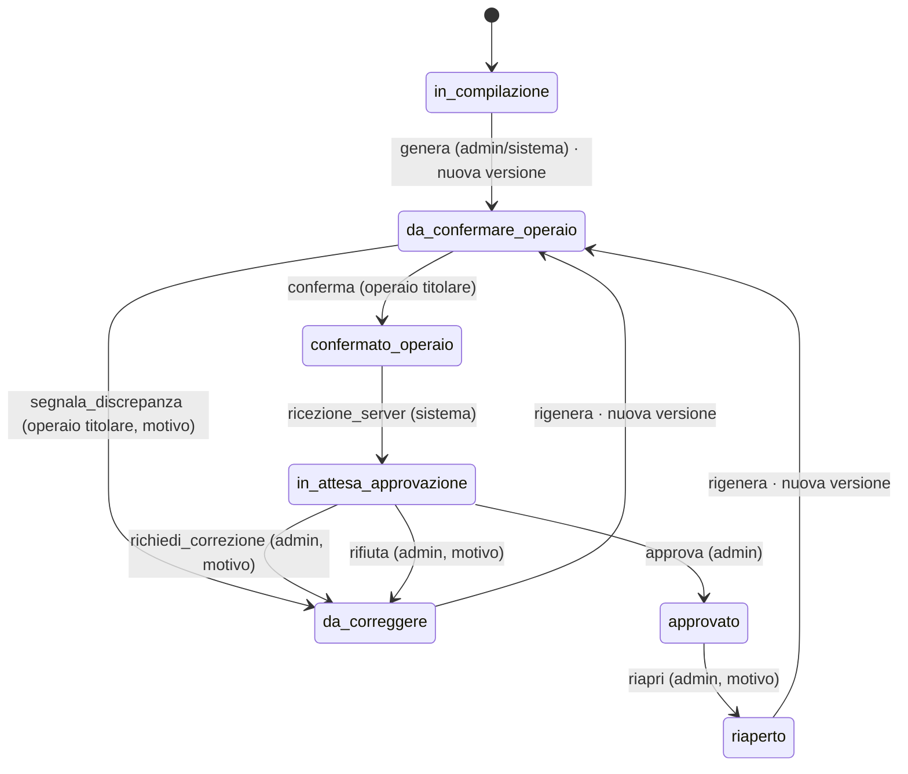
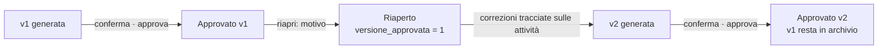

# 07 – Cartellini e approvazioni

Implementazione: `prototype/src/domain/timesheet-workflow.ts` (regole), `services/timesheet-service.ts` (persistenza), `database/migrations/0006_cartellini.sql` (stessa tabella delle transizioni con trigger di validazione). Test: T15–T20, E2E "giornata completa" e "richiesta di correzione e riapertura", verifiche SQL sul cartellino.

## 1. Concetti

- **Cartellino mensile**: una testata per operaio/anno/mese con stato, versione corrente e versione approvata.
- **Versione**: snapshot immutabile dei giorni e dei totali calcolati dal motore ore in un dato momento. Ogni correzione dopo la generazione produce una **nuova versione**; le precedenti restano consultabili.
- **Registro approvazioni**: una riga append-only per ogni transizione con utente, ruolo, istante, stato precedente, stato nuovo, versione, motivazione.

## 2. Stati e transizioni

| Stato | Etichetta | Ore del mese modificabili? | Chi agisce |
|---|---|---|---|
| `in_compilazione` | In compilazione | Sì | — (mese in corso) |
| `da_confermare_operaio` | Da confermare dall'operaio | **No** (serve segnalazione) | Operaio |
| `confermato_operaio` | Confermato dall'operaio | No | Sistema (alla ricezione) |
| `in_attesa_approvazione` | In attesa di approvazione | No | Amministratore |
| `da_correggere` | Da correggere | Sì | Operaio (correzioni) poi rigenera |
| `approvato` | Approvato | No | Amministratore (solo riapertura) |
| `riaperto` | Riaperto con motivazione | Sì | Operaio/Amministratore poi rigenera |

Tabella completa delle transizioni (codice e DB coincidono):

| Azione | Da | A | Attori | Motivazione | Nuova versione | Solo titolare |
|---|---|---|---|---|---|---|
| genera | in_compilazione | da_confermare_operaio | admin, sistema | — | sì | — |
| conferma | da_confermare_operaio | confermato_operaio | operaio | — | — | sì |
| segnala_discrepanza | da_confermare_operaio | da_correggere | operaio | **obbligatoria** | — | sì |
| ricezione_server | confermato_operaio | in_attesa_approvazione | sistema | — | — | — |
| approva | in_attesa_approvazione | approvato | admin | facoltativa | — | — |
| richiedi_correzione | in_attesa_approvazione | da_correggere | admin | **obbligatoria** | — | — |
| rifiuta | in_attesa_approvazione | da_correggere | admin | **obbligatoria** | — | — |
| rigenera | da_correggere, riaperto | da_confermare_operaio | admin, sistema, operaio | facoltativa | sì | — |
| riapri | approvato | riaperto | admin | **obbligatoria** | — | — |

### Perché "Confermato dall'operaio" e "In attesa di approvazione" sono stati distinti

Con l'offline la conferma avviene sul tablet anche senza rete. "Confermato dall'operaio" significa *confermato sul dispositivo*; diventa "In attesa di approvazione" **solo quando il server ha ricevuto la conferma** (transizione `ricezione_server`, attore sistema). L'amministratore non può approvare un cartellino che il server non ha ancora ricevuto, e l'interfaccia non dichiara mai "inviato" ciò che non è arrivato (D-06).

### Richiedi correzione vs Rifiuta

Entrambe portano a "Da correggere" con motivazione; si distinguono nel registro: *richiedi correzione* = errori puntuali; *rifiuta* = cartellino non accettabile nel complesso (es. mancano attività). In Fase 2 si possono differenziare notifiche e reportistica.

## 3. Regole

1. Il cartellino si **genera** solo se nel mese non ci sono giornate aperte (T20); "Chiudi mese" genera per tutti gli operai attivi e riporta esplicitamente chi è stato saltato e perché.
2. La **conferma** è rifiutata se i dati attuali differiscono dallo snapshot (confronto impronte): serve una nuova versione.
3. Solo l'**operaio titolare** conferma o segnala; l'amministratore non può farlo al suo posto (T15, verifica SQL).
4. Dalla generazione in poi le ore del mese sono **bloccate** (servizio + trigger `tg_blocco_mese`) negli stati non modificabili.
5. Un cartellino **approvato** non è modificabile silenziosamente: nessuna correzione è possibile senza `riapri` con motivazione; la riapertura conserva `versione_approvata` e la versione approvata resta archiviata.
6. Ogni transizione scrive un record in `approvazioni_cartellino` nella stessa transazione del cambio di stato; il trigger `tg_valida_stato_cartellino` rifiuta cambi di stato privi di registrazione, non ammessi, senza motivazione obbligatoria, con ruolo non abilitato o eseguiti da un non titolare.
7. Versioni e registro sono **append-only** (UPDATE/DELETE vietati da trigger).

## 4. Rettifiche e versioni

- La "rettifica" è la combinazione di: riapertura motivata + correzioni tracciate (righe di correzione con motivo, audit) + nuova versione + nuova conferma + nuova approvazione.
- Il confronto tra versioni mostra le differenze per giorno (effettive, attribuite, pause) e il confronto con i dati attuali rileva modifiche successive allo snapshot.
- I documenti PDF futuri riportano sempre la versione e, se esistono, le versioni precedenti approvate (docs/09).

## 5. Esperienza operaio (`#/op/cartellino`)

- Selettore mese (precedente al corrente), badge di stato, indicatore a 4 passi.
- Totali: giorni lavorati, ore effettive (con lorde e pause), attribuite, non attribuite, numero anomalie e correzioni.
- Giorni in **tabella** (entrata, uscita, pause, effettive, attribuite, non attribuite, anomalie, correzioni) o **calendario**; tocco su un giorno → riepilogo giornaliero.
- Azioni contestuali: "Confermo, è corretto" / "Segnala una discrepanza" (motivo obbligatorio) / "Ho corretto: genera nuova versione".
- Storico stati con utente, data e motivazione.
- Mese corrente non generato: anteprima dal vivo dichiarata come tale.

## 6. Esperienza amministratore (`#/admin/cartellini`, `#/admin/cartellini/:id`)

- Elenco del mese con stato, versione, totali, anomalie, stato di sincronizzazione; "Chiudi mese e genera".
- Verifica: azioni disponibili solo se ammesse (Approva, Richiedi correzione, Rifiuta, Riapri, Genera nuova versione), dialoghi con motivazione obbligatoria dove richiesto.
- Selettore di versione, differenze con la versione precedente o con i dati attuali, avviso se i dati sono cambiati dopo lo snapshot.
- Tocco su un giorno → giornata dell'operaio con storico correzioni.
- Registro approvazioni completo; elenco versioni con impronta.

## 7. Campi registrati per ogni operazione

| Campo | Fonte |
|---|---|
| Utente | `approvazioni_cartellino.utente_id` (null solo per `sistema`) |
| Ruolo | `ruolo_utente` |
| Timestamp | `eseguita_at` |
| Stato precedente / nuovo | `stato_precedente`, `stato_nuovo` (FK alla regola) |
| Versione | `versione` (FK alla versione esistente) |
| Motivazione | `motivazione` |
| Dispositivo | `device_id` |
