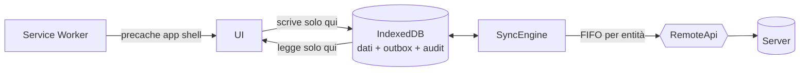
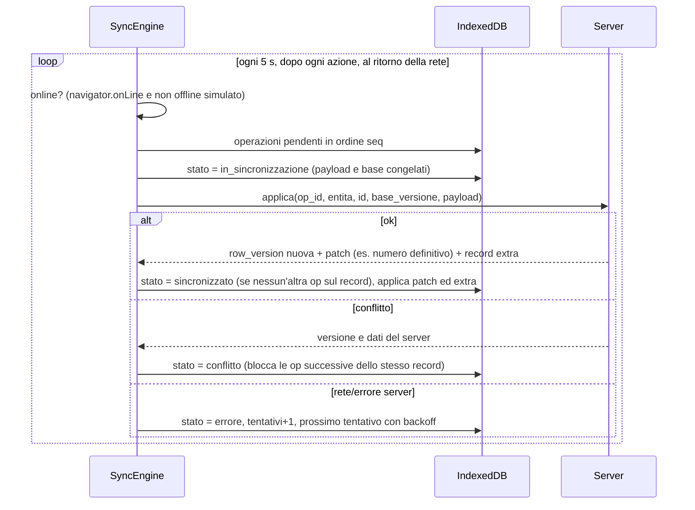

# 08 – Offline e sincronizzazione

Implementazione nel prototipo: `src/data/local-db.ts` (IndexedDB, UnitOfWork, outbox), `src/sync/sync-engine.ts`, `src/sync/mock-remote-api.ts` (**server simulato**), `vite.config.ts` (Service Worker). Test: T24–T28, E2E offline.

Stato: progettato e implementato contro un **server simulato nel browser**. Nessun backend reale è collegato; il sistema di sincronizzazione definitivo con Supabase è Fase 2.

## 1. Architettura offline-first



- **App shell in cache**: Workbox precarica JS, CSS, HTML, icone (`generateSW`, `navigateFallback: index.html`). L'app si apre senza rete dopo la prima visita. Aggiornamenti con `registerType: 'prompt'` per non ricaricare l'app durante una registrazione (D-09).
- **Dati necessari in locale**: profili, clienti, sedi, interventi (finestra temporale), squadre, presenze/attività/pause dell'operaio, rapportini propri, cartellini propri. Fase 2: download incrementale per `updated_at`, finestra di 90 giorni per l'operaio.
- **Salvataggio locale**: ogni azione è una transazione IndexedDB (record + outbox + audit). La cache in memoria viene aggiornata solo dopo il commit (T28).
- **UUID generati sul dispositivo** per ogni record e per ogni operazione.

## 2. Stati

| Stato | Significato | Dove si vede |
|---|---|---|
| `locale` | Solo sul dispositivo, non destinato all'invio (bozze di rapportino e loro allegati) | Badge "Solo sul dispositivo" |
| `in_attesa` | In coda, mai inviato o in attesa del turno | "In attesa di invio" |
| `in_sincronizzazione` | Richiesta in corso | "In sincronizzazione" |
| `sincronizzato` | **Risposta positiva del server ricevuta** e nessun'altra operazione pendente sul record | "Sincronizzato" |
| `errore` | Invio fallito (rete, timeout, errore server); ritentativo automatico con backoff | "Errore di invio" + messaggio e prossimo tentativo |
| `conflitto` | Il server ha una versione più recente: serve una scelta dell'utente | "Conflitto da risolvere" + azioni |

Lo stato esiste sia sull'**operazione** (outbox) sia sul **record** (badge nelle schermate). La pillola nella barra superiore riassume: offline / N in invio / N da verificare / tutto sincronizzato.

## 3. Coda delle operazioni (outbox)

```
OutboxOp {
  id               UUID = chiave di idempotenza
  seq              ordine di accodamento monotono sul dispositivo
  entita, entita_id
  stato, tentativi, ultimo_errore, prossimo_tentativo_at
  payload          null finché mai inviata; al primo invio si congela lo snapshot del record
  base_versione    row_version su cui si basa la modifica (fissata al primo invio)
  conflitto        { versione_server, dati_server } se il server rifiuta per concorrenza
}
```

Regole:

1. **Ordine**: si invia per `seq`. Un'operazione bloccata (errore in backoff o conflitto) blocca le successive **della stessa entità**, non le altre.
2. **Padre prima dei figli**: le operazioni di un batch sono accodate nell'ordine di salvataggio (es. rapportino prima delle sue foto). Bug trovato e corretto durante i test: con il solo timestamp, operazioni dello stesso batch potevano essere ordinate a caso → introdotto `seq` (T22).
3. **Coalescenza**: più modifiche allo stesso record finché l'operazione non è mai partita producono un solo invio con lo stato più recente.
4. **Mai payload diversi sotto lo stesso op_id**: se il record cambia dopo che un'operazione è partita o è in errore, si accoda una nuova operazione.
5. **Ritentativi**: backoff esponenziale 2 s, 4 s, 8 s… max 60 s; "Sincronizza ora" forza il ritentativo. Nessun limite di tentativi: un'operazione non viene mai scartata silenziosamente.
6. **Pulizia**: le operazioni confermate possono essere rimosse dalla coda (azione manuale nel prototipo; in Fase 2 dopo 7 giorni).

## 4. Ciclo di sincronizzazione



## 5. Idempotenza

- Il server (simulato ora, RPC in Fase 2) cerca `op_id` in `sync_operazioni`: se presente restituisce la risposta memorizzata **senza riapplicare** nulla.
- Caso tipico: il server applica, la risposta si perde (timeout) → il client ritenta con lo stesso `op_id` → riceve la stessa risposta. Verificato: T26 (contatore applicazioni del server resta 1) e simulazione "Risposta persa" nella pagina Sync.
- La scrittura e la registrazione dell'esito avvengono nella stessa transazione sul server.

## 6. Conflitti

**Rilevazione**: controllo di concorrenza ottimistico. Il client invia `base_versione`; se `row_version` sul server è diversa, il server non applica e risponde `conflitto`.

**Strategia di risoluzione per tipo di dato**:

| Dato | Strategia | Motivazione |
|---|---|---|
| Presenze, pause, attività | **Mai fusione automatica**: sono dati personali dell'operaio scritti quasi solo da un dispositivo; se c'è conflitto l'utente sceglie. Le attività nuove non confliggono mai (insert con UUID) | Le ore sono il dato più delicato |
| Correzioni di attività | Non confliggono: creano righe nuove; il marcare `superata_da_id` su una riga già superata è rifiutato dal server (trigger) → conflitto da risolvere | Storico immutabile |
| Rapportini | Insert una volta completati; dopo il completamento non si modificano (trigger) → nessun conflitto di contenuto | Documento firmato |
| Cartellino | Le transizioni sono validate dal server sullo stato corrente: se lo stato è cambiato (es. l'admin ha già riaperto), la conferma è rifiutata e il client riceve lo stato aggiornato | La macchina a stati è la fonte di verità |
| Interventi, anagrafiche | Modifiche dell'amministratore: conflitto mostrato con scelta; in Fase 2 fusione per campo quando i campi modificati sono disgiunti | Bassa frequenza |
| Stato intervento derivato (in corso, completato) | Ricalcolato dal server in base ai rapportini ricevuti | Evita "ultimo che scrive vince" |

**Risoluzione nel prototipo** (pagina Sync, test T27):

- *Mantieni mia versione*: si accoda una nuova operazione basata sulla versione del server (sovrascrittura consapevole), con riga di audit.
- *Usa versione server*: il record locale viene sostituito dai dati del server; il dato locale scartato resta nell'audit.

**Rifiuti di regole di business** (es. seconda presenza aperta dallo stesso operaio da due tablet): in Fase 2 la RPC risponde `esito = 'rifiutata'` con il motivo; il client lo mostra come conflitto da risolvere, mai come errore da ritentare all'infinito.

## 7. Allegati (foto e firme)

1. Foto/firma salvata in IndexedDB (prototipo: data URL ridimensionato a 1600 px; Fase 2: `Blob` in uno store dedicato) con stato `locale`.
2. Al completamento del documento l'allegato passa in coda **dopo** il record padre.
3. Fase 2: upload su Storage con percorso deterministico `allegati/{id}` (ritentabile e idempotente) + `sha256`; solo dopo la conferma dell'upload si invia l'operazione che registra `storage_path`. Upload grandi ripresi con TUS (supportato da Supabase Storage).
4. Lo spazio locale viene liberato solo dopo la conferma del server.

## 8. Recupero dopo riapertura

- All'avvio `LocalDb.init()` ricarica tutto da IndexedDB, compresa la coda (operazioni `in_sincronizzazione` rimaste a metà vengono ritentate: l'idempotenza rende sicuro il reinvio).
- Timer e pause aperti si ricostruiscono dai timestamp (T06, E2E).
- Giornate non chiuse → flusso di chiusura con proposta (T07).
- Sessione: nel prototipo la sessione è salvata localmente; in Fase 2 sessione Supabase persistente per lavorare offline anche dopo il riavvio.

## 9. Simulazioni disponibili (pagina `#/sync`)

| Interruttore | Effetto |
|---|---|
| Dispositivo offline | Nessun invio; tutto resta `in_attesa` |
| Errore del server (500) | Operazioni in `errore` con backoff |
| Risposta persa (una volta) | Il server applica ma il client non riceve la risposta: verifica dell'idempotenza |
| Modifica da altro dispositivo (una volta) | Il server incrementa la versione del record prima di applicare: conflitto |

Più "Ripristina dati demo" per ripetere le prove.

## 10. Limiti noti del prototipo

- Il server simulato vive nello stesso browser: operaio e amministratore sullo stesso dispositivo vedono lo stesso database locale (nella realtà ognuno ha il proprio e il server fa da tramite).
- Nessun download dal server (non esistono altri dispositivi reali).
- Gli allegati sono data URL in IndexedDB (limite pratico di qualche MB per file).
- Quota di archiviazione: in Fase 2 chiedere `navigator.storage.persist()` e monitorare `storage.estimate()`.
