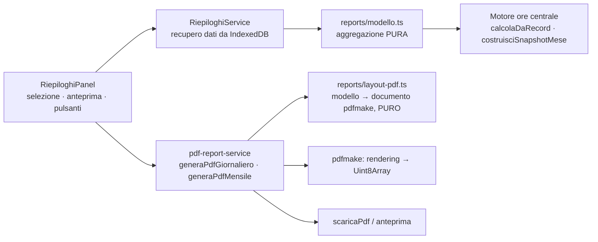

# 13 – Esportazione PDF dei riepiloghi giornalieri e mensili (Fase 2)

Stato: **implementato e verificato** nel prototipo. I dati provengono dal database locale (IndexedDB) e dal server di sincronizzazione **simulato**: non è collegato Supabase.

## 1. Cosa fa

| Funzione | Chi | Dove |
|---|---|---|
| Riepilogo giornaliero PDF | Operaio (solo i propri giorni), amministratore (qualsiasi operaio) | `#/op/riepiloghi` · `#/admin/report-presenze` |
| Riepilogo mensile PDF | Operaio (proprio), amministratore (qualsiasi operaio) | idem, scheda "Riepilogo mensile" |
| Anteprima a schermo | entrambi | stesso pannello, calcolata dallo stesso modello del PDF |
| Anteprima del PDF | entrambi | pulsante "Anteprima PDF" (visualizzatore del browser) |
| Collegamenti rapidi | — | dashboard operaio (riquadro "I miei riepiloghi"), dashboard admin ("Report presenze"), cartellino operaio e verifica cartellino ("PDF mensile") |

## 2. Libreria: pdfmake 0.2.20

Scelta già indicata nella Fase 1 (D-11), ora adottata. Motivi:

- **Layout multipagina dichiarativo**: intestazione delle tabelle ripetuta su ogni pagina (`headerRows`), righe mai spezzate (`dontBreakRows`), blocchi indivisibili (`unbreakable`), intestazione e piè di pagina con "Pagina x di y", filigrana.
- **Font Roboto inclusi** con caratteri accentati italiani; nessuna risorsa esterna, quindi **funziona offline**.
- Logo SVG supportato nativamente.
- Gira nel browser e in Node: gli stessi PDF vengono generati e analizzati nei test automatici.

Alternativa valutata: jsPDF + AutoTable (più leggera ma con layout imperativo, gestione manuale di salti pagina e font con accenti). Scartata.

Peso: pdfmake (1,2 MB) e font (0,8 MB) sono in **blocchi separati caricati solo al primo export** (import dinamico): l'avvio dell'app non cambia. Il Service Worker li tiene in cache (`maximumFileSizeToCacheInBytes` portato a 6 MB) per esportare anche offline.

## 3. Architettura

| Fase | File | Responsabilità |
|---|---|---|
| Recupero dati | `src/services/riepiloghi-service.ts` | Legge presenze, pause, attività (anche quelle corrette), rapportini, cartellino, versioni, approvazioni dell'operaio; regola funzionale "l'operaio vede solo i propri" |
| Calcolo e aggregazione | `src/reports/modello.ts` | Filtra per operaio/giorno/mese, chiama **una volta per presenza** il motore centrale, somma e raggruppa i suoi risultati; produce il modello documento |
| Modello documento | `src/reports/modello.ts` (tipi) | `RiepilogoGiornalieroDoc`, `RiepilogoMensileDoc`: valori già calcolati, `null` = non calcolabile |
| Rendering | `src/reports/layout-pdf.ts` + `pdf-report-service.ts` | Layout A4 e conversione in PDF; nessun calcolo di ore |
| Download/stampa | `pdf-report-service.ts` | `scaricaPdf()`, nome file leggibile; la stampa avviene dal visualizzatore PDF |
| Formattazione | `src/reports/formato.ts` | Date italiane, ore `HH:mm`, durate `HH:mm` |
| Configurazione azienda | `src/config/azienda.ts` | Ragione sociale, indirizzo, P.IVA, logo SVG (o `null`) |

**Nessuna seconda logica di calcolo**: il modello usa solo `calcolaDaRecord()` (giorno) e, per il controllo di coerenza con il cartellino approvato, `costruisciSnapshotMese()`. I test verificano che i totali del PDF coincidano con quelli del motore e dello snapshot del cartellino (R01, R12).

## 4. Regole di calcolo e integrità

| Regola | Come è garantita |
|---|---|
| Intervalli sovrapposti non sommati due volte | Durate = quota *effettiva* del motore; nota "Registrata X, conteggiata Y" sull'attività (R07) |
| Pause non contate come lavoro | Netta = lorda − pause dal motore; attività in pausa escluse (R02, E11) |
| Presenza ≠ attività | Totali separati: presenza lorda/netta vs ore attribuite a clienti/interne/trasferimenti vs non attribuite; nota esplicativa nel PDF mensile |
| Entrate/uscite mancanti non inventate | Presenza aperta di un giorno precedente e senza segnali dall'app → "non chiusa": uscita "non registrata", totali **non calcolati** (`null`), giorno escluso dai totali mensili e segnalato (R05, R10, R17) |
| Dati mancanti non trasformati in zero | Valori assenti stampati come "—" con legenda; zero solo quando la misura è davvero zero |
| Turni oltre mezzanotte | Il turno appartiene al giorno (e al mese) dell'entrata; l'ora di uscita del giorno dopo è indicata come "06:00 (11/03)" (R06, R18) |
| Fuso orario locale, niente errori UTC | Giorni dal campo `data_lavoro` (giorno locale dell'entrata); formattazione con l'ora locale, mai `toISOString()` per ricavare date |
| Solo l'operaio richiesto | Filtro `operaio_id` su presenze e attività (R08) |
| Solo il giorno richiesto | Filtro `data_lavoro = giorno`; attività legate alla presenza tramite `presenza_id` (R08) |
| Solo il mese richiesto | Filtro `data_lavoro` nel mese; cambio d'anno verificato (R18, R19) |
| Correzioni tracciate | Attività effettive con nota "Corretta/Da divisione/Inserita a mano + motivo"; sezione "Correzioni" con originale → nuova e motivo (R15) |
| Anomalie e dati incompleti | Riportati in testa e in chiusura del documento e nella colonna "Stato" del mensile |
| Quadratura | Il mensile verifica clienti + interne + trasferimenti = attribuite, attribuite + non attribuite = nette, nette + pause = lorde, somma per cliente e per interna; se non quadra l'export è bloccato |

## 5. PDF giornaliero

1. **Intestazione** (ogni pagina): logo, ragione sociale, indirizzo e P.IVA, titolo, operaio, identificativo documento.
2. **Titolo e dati**: "Riepilogo giornata lavorativa", data estesa, operaio e qualifica, stato della giornata, identificativo.
3. **Avvisi**: dati non sincronizzati, giornata in corso (totali provvisori "fino alle HH:mm"), uscita mancante.
4. **Presenze**: entrata, uscita (con valori registrati in origine se corretti), presenza lorda, pause, ore nette.
5. **Pause**: tipo, inizio, fine, durata; totale pause conteggiate.
6. **Dettaglio attività**, separato in *Lavori presso clienti*, *Attività interne*, *Trasferimenti*, *Attività non attribuite* (timer senza cliente + tempo di presenza senza attività): inizio, fine, durata, cliente, sede, intervento, tipologia e descrizione, note.
7. **Totali**: presenza lorda, pause, ore nette, ore attribuite ai clienti, ore interne, ore di trasferimento, totale attribuite, ore non attribuite (con quota da classificare).
8. **Rapportini** completati del giorno: numero (provvisorio se non ancora sincronizzato), cliente, intervento o "autonomo", descrizione sintetica, esito; bozze escluse e contate.
9. **Anomalie, correzioni e note**.
10. **Chiusura**: data e ora di generazione, autore, stato della giornata, stato dei dati, spazio firma operaio, dicitura "non sostituisce il cartellino approvato", legenda.

Filigrana "PROVVISORIO" se la giornata non è chiusa. Non esportabile se non c'è alcuna presenza (messaggio esplicito).

## 6. PDF mensile

- **Pagina 1 – riepilogo generale**: titolo, mese, operaio, periodo, data di generazione, identificativo; riquadro di stato ("CARTELLINO APPROVATO" con data, autore e versione, oppure "DOCUMENTO PROVVISORIO – NON APPROVATO" con lo stato); avvisi; giorni lavorati, senza presenza (di cui feriali), con uscita mancante, clienti, correzioni; totali ore come nel giornaliero; nota di quadratura e differenza presenza/attribuzione.
- **Tabella giornaliera** (nuova pagina): una riga per **ogni** giorno del mese — Data, Entrata, Uscita, Pause, Ore nette, Ore attribuite, Stato (Regolare, Corretta, Da verificare con motivo, Uscita mancante, In corso, Nessuna presenza, Non lavorativo); riga di totale. I giorni senza presenza hanno "—" e non sono contati come lavorati.
- **Dettaglio attività per giorno** (nuova pagina): una tabella per giorno con orario, cliente/attività, intervento, descrizione e note, durata; l'intestazione del giorno si ripete se la tabella prosegue nella pagina successiva.
- **Ultima sezione**: riepilogo per cliente (giornate, lavoro, trasferimenti, totale, numero interventi), attività interne, correzioni del mese, **stato del cartellino e approvazione** con storico completo (data, operazione, utente, versione, motivazione) e spazi firma.
- Se il cartellino non è approvato (o i dati non coincidono con la versione approvata): filigrana "PROVVISORIO" su ogni pagina, nome file con suffisso `_PROVVISORIO`, dicitura che l'esportazione non equivale all'approvazione.

## 7. Offline

- L'esportazione usa solo dati locali: funziona senza rete se l'app è già stata aperta (pdfmake e font sono in cache).
- Se il riepilogo include elementi non ancora confermati dal server, l'interfaccia e il PDF lo dichiarano ("Documento generato da dati non ancora sincronizzati con il server (N elementi)"). Un PDF non è mai indicato come sincronizzato.
- Se mancano dati (nessuna presenza) o i totali non quadrano, il pulsante è disabilitato e viene mostrato il motivo.

## 8. Identificativo e nome del file

- Identificativo: `RG-AAAAMMGG-<iniziali>-<impronta>` (giornaliero), `RM-AAAAMM-<iniziali>-<impronta>` (mensile). L'impronta deriva dal contenuto: due esportazioni con gli stessi dati hanno lo stesso identificativo, una modifica ai dati lo cambia.
- File: `riepilogo-giornaliero_2026-11-24_marco-rossi.pdf`, `riepilogo-mensile_2026-10_marco-rossi_PROVVISORIO.pdf`.

## 9. Incongruenze della Fase 1 trovate e corrette

| # | Incongruenza | Correzione compatibile |
|---|---|---|
| 1 | `costruisciSnapshotMese` contava le **righe** coinvolte nelle correzioni (una correzione = 2, una divisione = 3) | Nuova funzione `contaCorrezioni()` che conta le **operazioni**; usata da cartellino e PDF. Versione del seed demo portata a 5 (i dati demo si rigenerano) |
| 2 | Una presenza aperta veniva considerata "non chiusa" appena cambiava la data, quindi un turno notturno in corso dopo mezzanotte faceva comparire il blocco "giornata precedente non chiusa" | Nuova regola `statoPresenza()`: "non chiusa" solo se aperta da oltre 16 h o senza segnali dell'app da oltre 3 h (test T07b) — D-25 |
| 3 | Per una presenza vecchia mai chiusa il motore calcola "fino ad adesso" (uscita implicita) | I riepiloghi non calcolano le presenze "non chiuse" e lo dichiarano |

## 10. Passi per collegare Supabase reale (non eseguiti)

1. Implementare la sincronizzazione reale (docs/08, roadmap sprint 1): i riepiloghi leggono dal database locale, quindi funzionano senza modifiche una volta che i dati arrivano dal server.
2. Per l'amministratore: scaricare dal server le presenze/attività degli operai del periodo richiesto prima di generare (oggi sono tutte locali nel prototipo); mostrare "dati aggiornati al …".
3. Spostare `config/azienda.ts` in una tabella impostazioni (con logo in Storage, convertito in SVG/PNG data URL al download).
4. Facoltativo: generazione lato server (Edge Function con lo stesso `layout-pdf.ts`) per gli export aziendali massivi e per archiviare i PDF dei cartellini approvati con la loro impronta.
5. Registrare ogni esportazione in `audit_log` (oggi non registrata).
