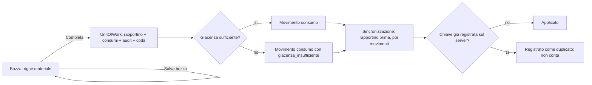

# 15 – Magazzino, materiali e costi (Fase 5)

Questo documento descrive l'anagrafica dei materiali, la gestione dei magazzini, i materiali nei rapportini e il calcolo dei costi. Si integra con i servizi esistenti: stessa `UnitOfWork` (record, coda di sincronizzazione e audit nella stessa transazione), stesso motore di sincronizzazione e stesso server simulato.

## 1. Cosa è stato realizzato

| Area | Funzione | Dove |
|---|---|---|
| Anagrafica | Codice (univoco, maiuscolo), nome, descrizione, categoria, unità di misura, prezzo di acquisto, prezzo di vendita facoltativo, fornitore, scorta minima, attivo/disattivato | *Magazzino → Materiali e giacenze → Nuovo materiale* o clic sulla riga |
| Magazzini | Più magazzini: sede e automezzi; un furgone può essere affidato a un operaio ed è il magazzino proposto per i suoi consumi | *Materiali e giacenze → Magazzini* |
| Movimenti | Carico (con documento e costo, con aggiornamento facoltativo del prezzo), scarico motivato, rettifica inventariale motivata (si indica la quantità contata), trasferimento tra magazzini | *Magazzino → Movimenti* |
| Giacenze | Calcolate dai movimenti, per magazzino e totali; valore; avviso sotto scorta; giacenze negative evidenziate | *Panoramica*, *Materiali e giacenze*, dashboard *Da fare* |
| Storico | Elenco movimenti filtrabile per materiale, magazzino e tipo, con autore, riferimento (rapportino, DDT) e stato di sincronizzazione | *Movimenti* |
| Rapportini | Materiali da anagrafica o a testo libero, quantità e unità, magazzino di prelievo, avviso di materiale insufficiente, scarico automatico al completamento | Rapportino (rapido e completo) → *Materiali* |
| Correzioni | Correzione del consumo su un rapportino completato, con motivo, senza modificare il documento né il movimento originale | Rapportino completato → *Materiali → Correggi* |
| Costi | Costo per intervento, per cliente e periodo, materiali più usati, consumi per lavoratore e per tipologia di intervento; valore a prezzo di vendita separato | *Magazzino → Costi e consumi*; *Panoramica*; scheda intervento; *Report* mensile (colonna *Materiali*) |

## 2. Modello dati

Tabelle nuove (migrazione `database/migrations/0009_magazzino_materiali.sql`, **solo preparata**): `materiali`, `magazzini`, `movimenti_magazzino`; viste `v_giacenze` e `v_costi_consumi`. La riga `rapportino_materiali` riceve `materiale_id` e `magazzino_id`, entrambi facoltativi: le righe a testo libero restano ammesse e non movimentano il magazzino. I campi sono descritti in `05-dizionario-dati.md`.

Il cuore è il **registro dei movimenti in sola aggiunta**:

- `quantita` ha segno (+ entra, − esce) e non è mai zero;
- `costo_unitario` è fissato quando si registra il movimento;
- un movimento non si modifica né si cancella. Sul database lo impone un trigger, nel prototipo il servizio crea solo movimenti nuovi. Le correzioni sono **nuovi** movimenti collegati (`corregge_id`), e le due metà di un trasferimento condividono `trasferimento_id`;
- la **giacenza non è memorizzata**: è la somma dei movimenti validi, cioè non eliminati né scartati come duplicati.

Così due dispositivi offline non possono sovrascriversi la giacenza: ognuno aggiunge movimenti e la somma resta corretta.

## 3. Consumi dai rapportini

- La **bozza non scarica**: si può salvare quante volte si vuole.
- Al **completamento** viene creato un movimento `consumo` per ogni riga collegata all'anagrafica. Il movimento è collegato a rapportino e riga, intervento, cliente e operaio, e registra il costo e il prezzo di vendita del momento. Rapportino e consumi entrano nella stessa transazione locale; nella coda di invio il rapportino (padre) precede i movimenti.
- **Nessun doppio scarico**:
  1. un rapportino si completa una volta sola;
  2. il servizio scarica solo la differenza tra la quantità della riga e quanto risulta già scaricato per quella riga;
  3. i ritentativi di sincronizzazione riusano lo stesso `op_id`, quindi il server non riapplica;
  4. ogni consumo porta la chiave univoca `consumo:<rapportino>:<riga>`. Se arriva un secondo movimento con la stessa chiave (da un altro dispositivo o da un reinvio), il server lo registra con `duplicato_di` e quel movimento resta visibile, barrato, ma non conta. Sul database la chiave è protetta da un indice univoco.
- **Materiale insufficiente**: l'editor avvisa mentre si compila, considerando anche più righe dello stesso articolo e il magazzino scelto. Il completamento non viene bloccato, perché il materiale è stato usato davvero: il consumo è registrato con `giacenza_insufficiente` e l'amministrazione lo vede nella *Panoramica* (giacenze negative e consumi segnalati), così può fare un carico o una rettifica.
- **Correzione del consumo** (amministratore o autore del rapportino): si indica la quantità effettivamente usata e il motivo. Il servizio aggiunge un movimento `correzione_consumo` con la differenza:
  - allo **stesso costo unitario** e nello stesso magazzino del consumo originale;
  - con la stessa data di competenza.

  Il rapportino firmato non cambia. La vista del rapportino mostra la quantità del documento, la quantità scaricata, la cronologia delle correzioni e, per l'amministratore, il costo effettivo.

## 4. Costi

| Grandezza | Regola |
|---|---|
| Costo di un consumo | `−quantità × costo_unitario` del movimento (consumo + correzioni) |
| Valore a prezzo di vendita | `−quantità × prezzo_vendita_unitario` del movimento; mostrato **separato** dal costo; assente se il materiale non ha prezzo di vendita |
| Periodo | data di competenza = giorno del rapportino (una correzione successiva resta sul giorno del rapportino) |
| Valore delle giacenze | giacenza totale positiva × prezzo di acquisto **attuale** (valore di riacquisto); le giacenze negative valgono 0 |
| Cambio prezzo | modifica l'anagrafica e vale solo per i movimenti successivi; l'audit registra il vecchio e il nuovo prezzo |

Tutti i totali (dashboard, *Costi e consumi*, scheda intervento, colonna *Materiali* del report mensile) vengono dalla stessa funzione pura `riepilogaConsumi` (`prototype/src/domain/magazzino.ts`), richiamata da `MagazzinoService.riepilogoCosti`: nessuna logica duplicata nella UI.

## 5. Offline e conflitti

- Tutte le registrazioni (anagrafica, movimenti, consumi, correzioni) funzionano offline e finiscono nella coda di sincronizzazione esistente, con lo stato visibile su ogni movimento.
- I movimenti sono solo inserimenti, quindi non generano conflitti di versione.
- Anagrafica materiali e magazzini usano il normale controllo di concorrenza (`row_version`) e la risoluzione dei conflitti già presente nella pagina *Sync*.
- Nessun incremento o decremento di contatori: due scarichi offline dello stesso articolo da due dispositivi producono due movimenti, e la giacenza risultante è corretta.

## 6. Dati dimostrativi

Il seed (versione 6) crea:

- 11 articoli in 4 categorie;
- 3 magazzini: sede centrale e i furgoni di Marco e Andrea;
- un carico iniziale e una dotazione dei furgoni;
- i consumi di tutti i rapportini storici, collegati alle righe;
- una rettifica di fine mese, un reso al fornitore e un carico recente con nuovo prezzo: il filtro deidratatore passa da 18,50 € a 21,00 €, e i consumi precedenti restano a 18,50 €.

Due articoli sono sotto scorta (gas R32 e magnetotermico). I dati delle fasi precedenti non cambiano, perché il magazzino usa un generatore casuale separato. Al primo avvio dopo l'aggiornamento i dati demo vengono rigenerati.

## 7. Verifiche eseguite

| Verifica | Esito |
|---|---|
| Vitest `tests/unit/magazzino.test.ts` (M01–M06): anagrafica, movimenti, giacenze, sotto scorta, scarico al completamento, nessun doppio scarico, insufficienza, correzione con costo storico, costi per cliente/operaio/tipologia, offline con risposta persa, duplicato logico scartato dal server, coerenza del seed | 6/6 |
| Suite Vitest completa | 74/74 |
| Playwright `tests/e2e/fase5.spec.ts`: materiale dal magazzino, avviso, scarico, correzione, dashboard, carico, costi | 1/1 (suite completa 8/8) |
| `database/tests/verifica_regole.sql` su PostgreSQL 16 locale usa e getta: codice univoco, prezzi non negativi, scarico motivato, consumo collegato, doppio scarico rifiutato, movimenti immutabili, giacenza dalla vista, costo storico dopo il cambio prezzo | tutte OK |

## 8. Limiti e questioni aperte

- **Valorizzazione**: il costo del consumo è il prezzo di acquisto in anagrafica al momento dello scarico, non un costo medio ponderato né il FIFO dei lotti caricati (decisione D-31). Va confermato con l'amministrazione.
- **Giacenze negative ammesse** sui consumi da rapportino (D-32): segnalate, non bloccate. Gli scarichi manuali e i trasferimenti invece sono bloccati se la giacenza non basta.
- **Duplicati**: il server simulato marca il duplicato. Nel backend reale, la RPC `sync_apply` dovrà intercettare la violazione di `movimenti_chiave_uk` e registrare il movimento con `duplicato_di`. Questo non è ancora implementato, perché non esiste un backend reale.
- **Ordini a fornitore**, lotti, matricole e inventari guidati non sono previsti in questa fase.
- Il PDF dei rapportini non è ancora presente nel progetto, quindi i costi dei materiali non compaiono in un documento cliente.
